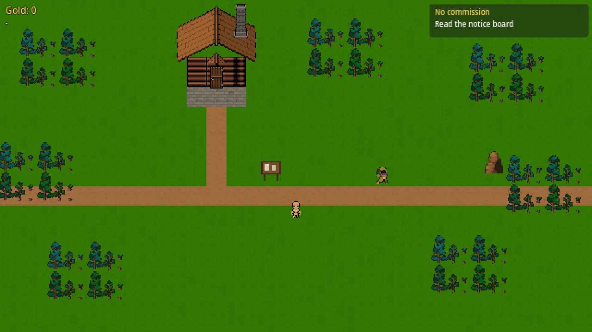
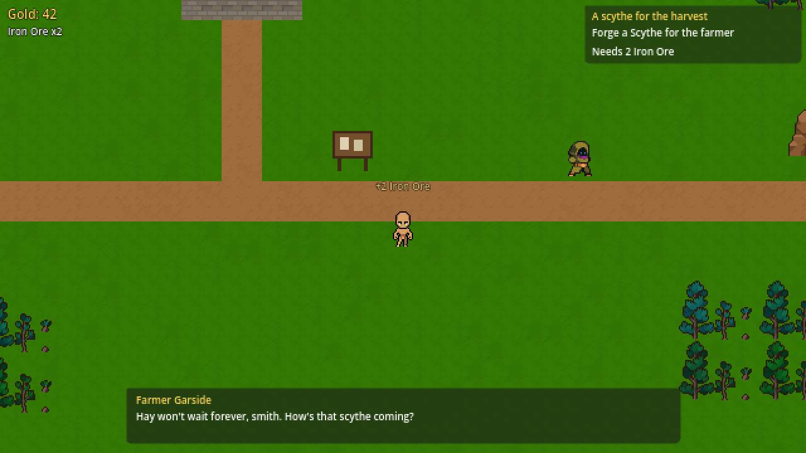
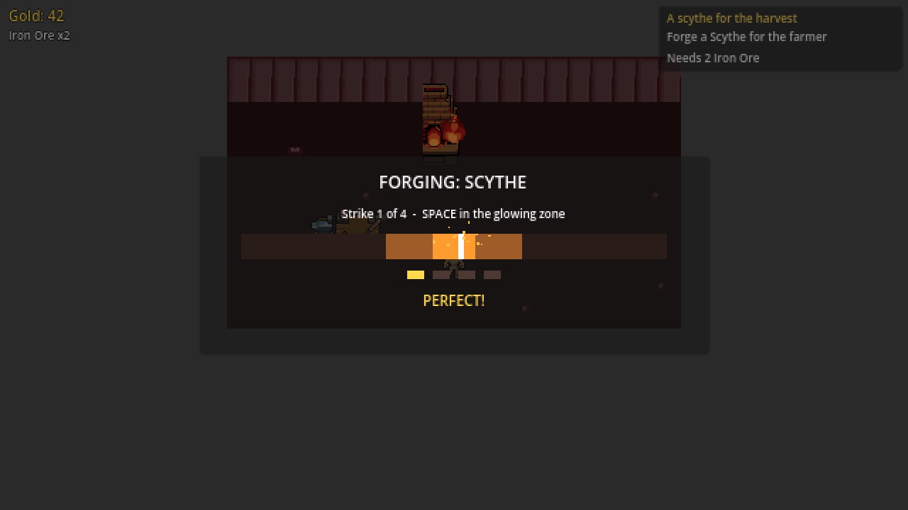

# Brookside Forge

A cosy top-down pixel-art sim set in post-war Yorkshire. You inherit the
village blacksmith's forge and help a community get back on its feet, one
commission at a time. Stardew Valley pacing, an older audience, and
blacksmithing at the heart of it.



## The proof of concept

This repo isn't the game. It's here to find out whether the core loop is fun.
You take a job from the notice board, mine ore from the rock, hammer the item
into shape at the anvil, hand it to the farmer for gold, and go again.
Everything else (farming, seasons, more villagers, dialogue trees, menus) is
left out on purpose, so the loop has to stand on its own.

The whole loop now works. Three commissions cycle in turn (a scythe,
horseshoes and gate hinges), each with its own ore cost and pay. Mining has a
swing and floating "+1 Iron Ore" text, and the hammer mini-game has sparks,
sound and a strike counter. There's a HUD, and your progress saves.

|  |  |
|---|---|
| Two ore in hand and the farmer still waiting on that scythe | A perfect first strike at the anvil |

That leaves the question the POC was built to answer: **do people smile during
the mini-game, and do they forge a second item without being asked?**
[PLAYTEST.md](PLAYTEST.md) covers how to run that session.

Known gaps: the notice board is placeholder art, the sound effects are
generated stand-ins, and the pack art reads more fantasy than Yorkshire. That
last one decides whether the full game needs an art budget.

## Running it

Open the project in **Godot 4.6** and press F5, or from the repo root:

```
godot --path .
```

**Controls:** WASD or arrow keys to move, **E** to interact, **Space** to
strike in the mini-game.

## How it's built

Typed GDScript at a pixel-perfect 640×360, using the licensed Pixel Crawler art
packs. The structure is small and deliberately strict:

- **One scene per logical unit** in `scenes/`, each with a matching script.
- **Three autoloads** in `autoload/`: `Events` (a signal bus, so systems never
  reach into each other's node paths), `DataLoader` (reads items, recipes and
  commissions from `data/*.json`) and `GameState` (gold, inventory and
  commission progress, saved to `user://save.json`). The HUD is autoloaded
  too, so it survives scene changes.
- **An `Interactable` component** (`scenes/components/`) sits behind every
  "press E" moment: the notice board, ore rock, doors, anvil and farmer.
- **Game data lives in JSON.** To change pay, ore costs or commission text,
  edit `data/` instead of the code.

## Dev tools

These run from the repo root without opening the editor:

| Command | What it does |
|---|---|
| `godot --headless --path . res://tools/test_runner.tscn` | Smoke test of the whole loop, from save/load through board, ore, forge and delivery. Prints `TEST OK` or `TEST FAIL`. |
| `godot --headless --path . res://tools/build_village.tscn` | Regenerates `scenes/village.tscn` from script. |
| `godot --headless --path . res://tools/build_forge_interior.tscn` | Regenerates `scenes/forge_interior.tscn` from script. |
| `godot --path . res://tools/screenshot_runner.tscn ++ <scene> [zoom] [options]` | Renders a scene and saves a 2× screenshot. Options are listed at the top of the script. |

The two build tools **overwrite** their scenes, so make layout changes in the
tool scripts rather than in the editor.

To refresh the README screenshots (this opens a window briefly, so it can't
run headless):

```
godot --path . res://tools/screenshot_runner.tscn ++ res://scenes/village.tscn 0.67 out=docs/screenshots/village_overview.png
godot --path . res://tools/screenshot_runner.tscn ++ res://scenes/village.tscn 0 demo out=docs/screenshots/village_hud.png
godot --path . res://tools/screenshot_runner.tscn ++ res://scenes/forge_interior.tscn 0 minigame out=docs/screenshots/minigame.png
```

## Repo layout

```
autoload/    Events, DataLoader, GameState
scenes/      one .tscn + .gd per unit; components/ holds reusable pieces
data/        items.json, commissions.json
assets/      audio, tilesets, and packs/ (licensed art)
tools/       dev tools above (not part of the game)
docs/        README screenshots
_archive/    original pack zips and unused packs, ignored by Godot
```

## Docs

- [CLAUDE.md](CLAUDE.md): scope, conventions and working rules
- [POC_PLAN.md](POC_PLAN.md): the original session-by-session plan
- [PLAYTEST.md](PLAYTEST.md): running a playtest and what to watch for
- [TODO.md](TODO.md): known gaps and follow-ups
- [assets/packs/README.md](assets/packs/README.md): sprite sheet layouts

## Licensing

The Pixel Crawler packs (Anokolisa, itch.io) are paid assets and must not be
redistributed. They're committed here only because the repo is private. If it
ever goes public, remove `assets/packs/` and `_archive/` from the git history
first, not just from the latest commit.
